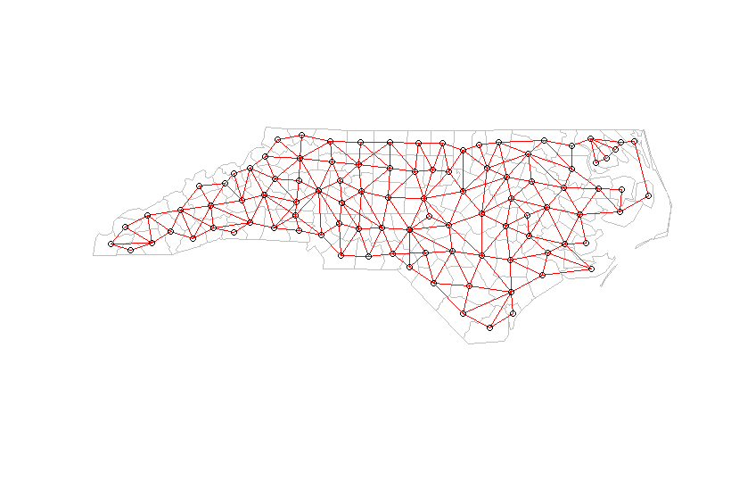
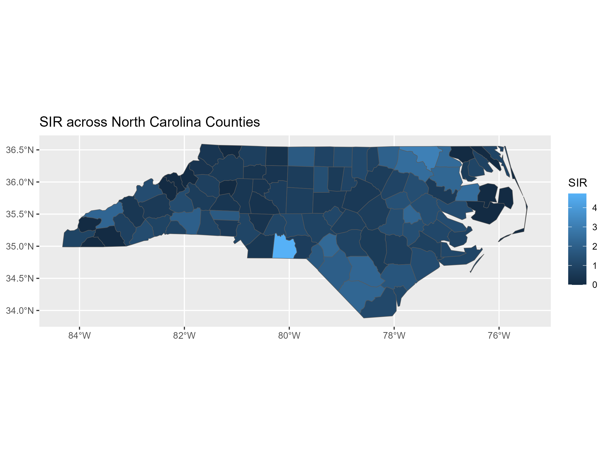
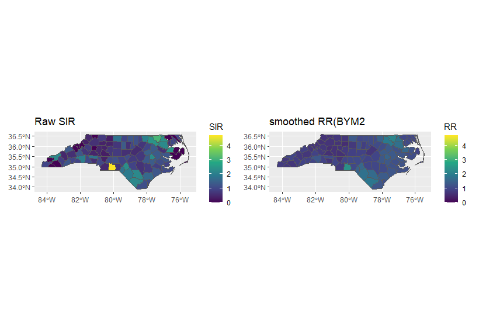
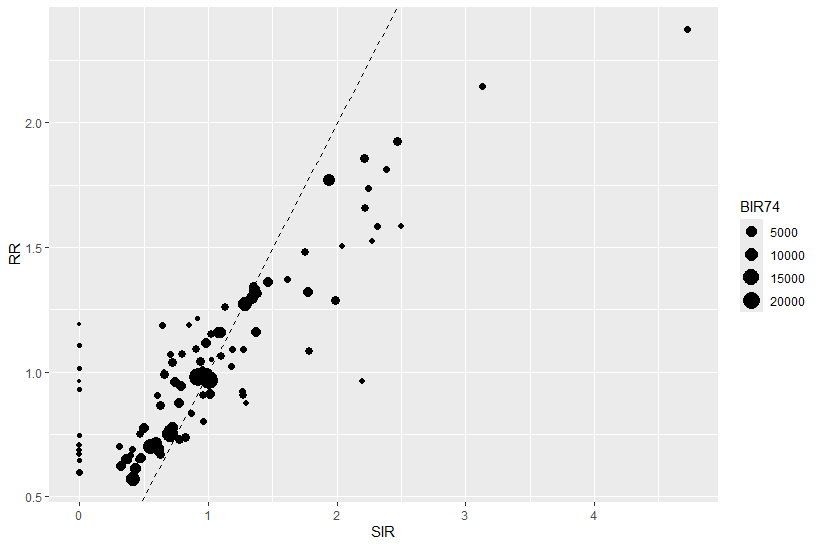

# Bayesian Spatial Smoothing of SIDS Risk in North Carolina Counties (1974)

## Overview
Sudden infant death syndrome (SIDS) is the sudden, unexplained death of an infant under one year of age. This project uses county-level SIDS data from North Carolina in 1974 to identify counties with more deaths than expected. 

Because counties differ in the number of births, deaths cannot be compared directly. So I calculated the standardized incidence ratio(SIR). SIR compares the observed deaths with the number expected under the statewide rate. An SIR above 1 means more deaths than expected, and below 1 means fewer.

However, SIR is unstable in small counties, where the expected count is low. A few extra cases can change the ratio a lot. It also gives no measure of uncertainty. So I fitted a Bayesian BYM2 model in R-INLA. This model borrows information from the neighbouring counties and gives smoothed relative risks with credible interval.

- **Data:** `nc.shp` from the `sf` package (100 counties; `SID74` = SIDS deaths, `BIR74` = live births, 1974)
  
- **Methods:** raw SIR, then a Poisson BYM2 model in R-INLA

- **Output:** county adjacency network, maps of raw SIR (static and interactive) and smoothed RR, and a scatter plot of SIR  against RR.

## Methods

### 1. Raw SIR

Expected deaths = births (BIR74) x statewide SIDS rate.
The statewide rate is total SID74 divided by total BIR74.
SIR = observed deaths / expected deaths. 

### 2. Neighbourhood structure 

Counties that share a border are defined as neighbours (spdep, poly2nb).
The 100 counties have 490 links in total.
Each county has 4.9 neighbours on average ( range 2 to 9).
No county is isolated. 
This network is the spatial structure used by the BYM2 model.

Each point is a county and red lines connect neighbouring counties.

### 3. Bayesian model

I used a Bayesian BYM2 model in R-INLA. 
SIR is unstable in small counties, so I wanted a more stable estimate. 
The model uses information from neighbouring counties. 
It gives a relative risk (RR) for each county, with a 95% credible interval.
The model has no covariates, so it shows where risk is higher, but not why.

## R Packages

- `sf`: reads the North Carolina map data

- `spdep`: finds neighbouring counties

- `INLA`: fits the Bayesian BYM2 model

- `ggplot2`: draws maps and plots

- `patchwork`: places two maps side by side

- `mapview`: makes the interactive SIR map

- `htmlwidgets`: saves the interactive map as an HTML file

INLA is not on CRAN. Install it from https://www.r-inla.org/download-install

## Results

### Raw SIR

Anson had 15 observed deaths and 3.17 expected deaths, so its SIR is 4.73.
Northampton had 9 observed deaths and 2.87 expected, so its SIR is 3.13.
Washington had an SIR of 2.50.
These counties have small expected counts, so their SIRs can change a lot with a few extra cases.

This map shows the raw SIR for each county. 

An interactive version of this map is in the file `SIR_interactive.html`.
Download the file and open it in a web browser. Click on a county to see its SIR. 

### Smoothed RR

| County | SIR | RR | 95% interval |
|---|---|---|---|
| Anson | 4.73 | 2.37 | 1.29 to 4.05 |
| Northampton | 3.13 | 2.15 | 1.19 to 3.63 |
| Washington | 2.50 | 1.58 | 0.82 to 2.81 |

The RR is lower than the SIR in all three counties. 
For Anson and Northampton, the interval is fully above 1, so the risk is higher than average. 
For Washington, the interval includes 1, so we cannot be sure. 

The left map shows the raw SIR and the right map shows the smoothed RR.
Both maps use the same colour scale. 

48 of the 100 counties had an RR above 1, but only 5 had an interval fully above 1. 

### Shrinkage 

Each point is a county. The dashed line is where SIR equals RR. 
Counties with a high SIR are below the line, so the model lowers them.
Counties with a low SIR, including SIR = 0, are above the line, so the model raises them.
Both move towards the average (RR=1)
Counties with few births (small points) change the most. 

## Limitations
- The data are from 1974 and are grouped by county.
- The model has no covariates, so it shows where risk is higher, but not why.
- The results show patterns, not causes.
- The intervals are wide because the expected counts are small. \

## Requirements

- R 4.6.1 (the version used in this project)
- The R packages: sf, spdep, INLA, ggplot 2, patchwork, mapview, htmlwidgets
- The first installation can take a long time, because sf and mapview need many other packages.

## How to run

1. Install the packages. In R, run:
   
   install.packages(c("sf", "spdep", "ggplot2", "patchwork", "mapview", "htmlwidgwts"))
   
   Then install INLA from https://www.r-inla.org/download-install
2. Download `nc_sids_bym2.R` from this repository.
3. Open the R script in R or RStudio.
4. To save files, set the working directory first: Session> Set Working Directory> Choose Directory, and select a folder. 
5. Run the script.

The figures were exported from RStudio (Plots> Save as Image)
   
